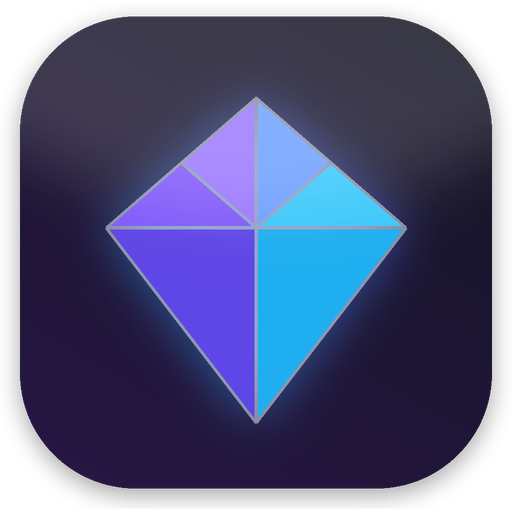

# CHROVIQ

Make Windows look and work the way you want. CHROVIQ replaces and extends parts of the Windows shell, and
everything in it can be customized. Website: [chroviq.com](https://chroviq.com).

- **Taskbar and dock**: design your own bars (modules, zones, colors, materials), a floating dock, auto-hide, a design
  per monitor, pinned apps you can drag to reorder, window previews (also of minimized windows)
- **Start menu, search, Alt+Tab and Quick Settings** of its own: recent files, folder shortcuts, opening animations
  and live glass
- **Shader materials**: glass, aurora, painted and animated surfaces, Direct3D materials for real blur and refraction
  (Frosted glass, Refraction glass), or write your own in HLSL
- **Desktop**: widgets (clock, stats, weather, media, notes), web widgets anyone can make in HTML and JavaScript,
  snap layouts, a daily wallpaper, Windows 11-style menus
- **Profiles**: switch a whole look (dark/light, accent, wallpaper or Wallpaper Engine, cursors, taskbar) at once, by
  hand or automatically by time of day or a running game
- **Shell mode** (optional): run CHROVIQ instead of Explorer, with its own desktop (icons on every monitor), a welcome
  screen after sign-in, Win+A (Quick Settings) and Win+N (calendar), and a failsafe that brings Explorer back
- **Eight languages**: English, Dutch, German, French, Spanish, Simplified Chinese, Japanese and Korean

## Made with AI

CHROVIQ is designed and directed by IdkMyNaam and built with the help of AI: the code, documentation and
installer were written together with Anthropic's Claude, through Claude Code. Every feature is tested by hand on
real hardware before it ships.

CHROVIQ is not made by or affiliated with Microsoft. Windows is a trademark of Microsoft.

## Install

Download `CHROVIQ-Setup-<version>.exe` from [chroviq.com](https://chroviq.com) or [Releases](../../releases) and run
it. It installs for your account only (no admin needed). Windows 10 2004 or newer, or Windows 11, 64-bit.

The setup isn't signed yet, so the first time Windows SmartScreen may say "Windows protected your PC":
click **More info**, then **Run anyway**.

CHROVIQ looks for updates once a day (you choose when to install). Uninstalling puts Explorer and the
Windows taskbar back and asks whether to keep your settings.

## If something goes wrong

- **Windows taskbar gone:** run `Restore-Taskbar.ps1` (next to the app). The app also restores it itself, even
  when it's killed, through its watchdog.
- **Using CHROVIQ as the shell and something is wrong:** if CHROVIQ closes, Explorer starts by itself. Otherwise:
  Ctrl+Alt+Del > Task Manager > File > Run new task > `explorer.exe`; then run `Restore-Shell.ps1` (next to the
  app) to make Explorer the shell again from the next sign-in.
- **Can't use your own account at all:** sign in to another admin account, open PowerShell as administrator and
  run `Restore-Shell.ps1 -ForUser <your user name>`.
- **Report a problem or ask a question:** Help & support > "Report a problem..." sends it to the developer, with the
  logs if you want (you see everything before it's sent). "Save as .zip instead" puts the logs and details in a .zip
  on your desktop, and nothing is sent.

## Making your own

- **Widgets:** a folder with `widget.json` and an HTML page. See [Widgets/README.md](Widgets/README.md).
- **Materials:** a folder with `material.json` and `material.hlsl`. See [Materials/README.md](Materials/README.md).
- **Translations:** About > Language > "Make a translation file...".

## Building

.NET 8 SDK, Windows. `dotnet build` builds it; `Scripts\Build-Installer.ps1` makes the setup (needs
[Inno Setup 6](https://jrsoftware.org/isinfo.php)).

| Folder | What's in it |
|---|---|
| (top) | `Program.cs` (the entry point, and the shell launcher), `App.xaml` (app start, crash handlers), project file, `app.manifest` (per-monitor DPI) |
| `Main/` | Main window, settings, tray icon, hotkeys, app themes, setup wizard, backup, logs, updates, translations, problem reports |
| `Themes/` | Profiles, applying a profile, accent color, cursors, automatic profile switching |
| `WallpaperEngine/` | Controlling Wallpaper Engine, game mode, the Workshop wallpaper picker |
| `Taskbar/` | The custom taskbar: bar window, AppBar, `TaskbarView` (draws a design), modules, designs + designer, animations, watchdog |
| `Taskbar/WindowList/` | Open windows, grouping by app, previews and snapshots, pinning, force close |
| `Taskbar/SystemInfo/` | Tray icons (ManagedShell), media, volume, CPU/memory, virtual desktops |
| `Launcher/` | Start menu, search, Quick Settings, calendar, Alt+Tab, Windows-key hook, opening animations |
| `Materials/` | Shader materials: compiler, effects, live glass, Direct3D renderer, built-in materials |
| `Shell/` | Shell mode, launcher, the desktop, widgets (and web widgets), snap layouts, welcome and sign-in screen, daily wallpaper, startup programs |
| `Widgets/` | The web widgets that come with CHROVIQ, and the guide for making them |
| `Languages/` | The translations |
| `Native/` | Win32 functions used in several places |
| `Scripts/` | Recovery scripts (copied next to the app), the installer build script |
| `Installer/` | The Inno Setup script |
| `Relay/` | The Cloudflare Worker that passes problem reports on to the developer (not part of the app) |
| `docs/` | Extra notes (Wallpaper Engine integration) |

Settings and data are in `%AppData%\WindowsCustomizer\` (the folder kept its first name so settings carry over).

## Support

CHROVIQ is free. If you enjoy it, you can support its development on [Ko-fi](https://ko-fi.com/idkmynaam). Thank you!

## License

CHROVIQ is released under the [MIT License](LICENSE).
